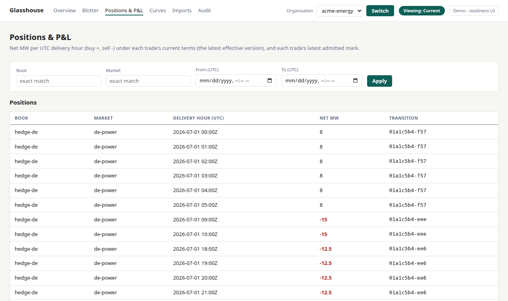

# Glasshouse

Glasshouse is an open-source system of record for power trading. It keeps a firm's trades, price curves, positions and valuations in one place, with a complete history of every change.

**See it running: [glasshouse.a115.co.uk](https://glasshouse.a115.co.uk).** A small demo trading book: German power in euros and British power in pounds, with hourly positions, position limits, valuations, a corrected price curve, and the history behind them. The Imports screen has a sample file, so you can watch a trade being refused in one click. The login is shared. Ask [Jordan on LinkedIn](https://www.linkedin.com/in/jdimov) for the password, or run it yourself in a few minutes (below).



## Why it exists

A small power trading team, or a company running batteries or renewables, has two choices today. Spreadsheets and a home-made trade table are hard to audit. Vendor systems are expensive and closed.

Glasshouse sits between them: a book of record you can read, run and check yourself.

## What makes it different

- **Nothing is overwritten.** A corrected curve or an amended trade is a new version beside the old one. The old figure, and every valuation made from it, stays on the record. Pick a past time and the trades and positions screens show the book as it stood then.
- **Bad changes are refused, with a reason.** The rules live in [one readable file](src/glasshouse/commit/glasshouse.morph). A change that breaks one is not saved, and the refusal names the rule and the figures: this trader may not trade this book, this trade would take the book to 26 MW in this hour and its limit is 25.
- **Every valuation shows its sources.** It records the exact curve version and trade terms it was computed from, so last week's number can be explained this week.
- **You can check the records yourself.** One button, or one command, confirms the database still agrees with its own history. Another exports that history for an outsider to verify offline.
- **Software is held to the same rules as people.** An AI agent can connect, read the book and propose trades under its own name. It is refused exactly where a trader would be, and gets the reason back as data. [docs/mcp.md](docs/mcp.md) shows how.

## How the rules are enforced

Glasshouse is built on [Morpholog](https://github.com/jordan-dimov/morpholog), a separate open-source project: a small language for writing business rules, and an engine that runs them on PostgreSQL.

Every change to the book is a proposal. Morpholog checks it against the rule file and saves it only if every rule still holds. It keeps a tamper-evident record of each change it accepted.

Glasshouse could have put its rules in application code. It does not, for three reasons. The rules sit in one file anyone can read. They are enforced in one place, outside the code that proposes changes, so a bug, a script or an AI agent working through Glasshouse cannot get round them. And the history can be replayed and checked by someone who does not trust us.

## Where it stands

Early. It handles one product, fixed-price power, from end to end: CSV imports, hourly positions, valuations, corrections, amendments and position limits. An open order can be recorded as an instruction, which holds its room under the limit until it ends. Each market is priced in its own currency, and currencies are never added together. There is a web interface, an HTTP API, and a way in for AI agents (MCP).

One limit to know about. The history holds every change that was accepted. Refusals are kept in a separate, shorter list that is not guaranteed complete.

It is ready to evaluate, not yet to run a desk on. [SCOPE.md](SCOPE.md) says plainly what it is not.

## Where it is going

None of this exists yet. It is the road ahead.

- **Every screen at any past moment.** Trades and positions can already be viewed as they stood at a chosen time. Next is the same for curves, the overview and the history screens.
- **Run beside what you have.** Import your spreadsheet's or current system's exports, compare daily, and see exactly where the two differ.
- **More of the lifecycle.** Counterparty confirmations, settlement, and products such as power purchase agreements and battery storage.
- **More for software that trades.** Agents can read the book and propose a trade today. Next: amendments, prices and valuations as tools, and a sign-in of their own for each agent.

[DESIGN.md](DESIGN.md) has the full plan and the reasoning.

## Run it locally

You need Python 3.13 or later, [uv](https://docs.astral.sh/uv/) and Docker.

```bash
./scripts/install-morpholog.sh ~/.local/bin
export GLASSHOUSE_MORPHOLOG_BIN=~/.local/bin/morpholog
docker compose up -d
uv sync
uv run python -m glasshouse.cli seed --reset
uv run uvicorn glasshouse.api.app:app
```

Then open <http://localhost:8000/ui> and try the sample on the Imports screen. These steps download the Morpholog engine, start a local PostgreSQL, install the Python packages, load the demo book and start the server.

Tests, the command-line tools, configuration and deployment are in [docs/development.md](docs/development.md).

## Licence and contact

Apache 2.0, see [LICENSE](LICENSE). Questions, ideas and contributions are welcome through [GitHub issues](https://github.com/jordan-dimov/glasshouse/issues). To see the demo or talk about using Glasshouse, reach [Jordan on LinkedIn](https://www.linkedin.com/in/jdimov).
